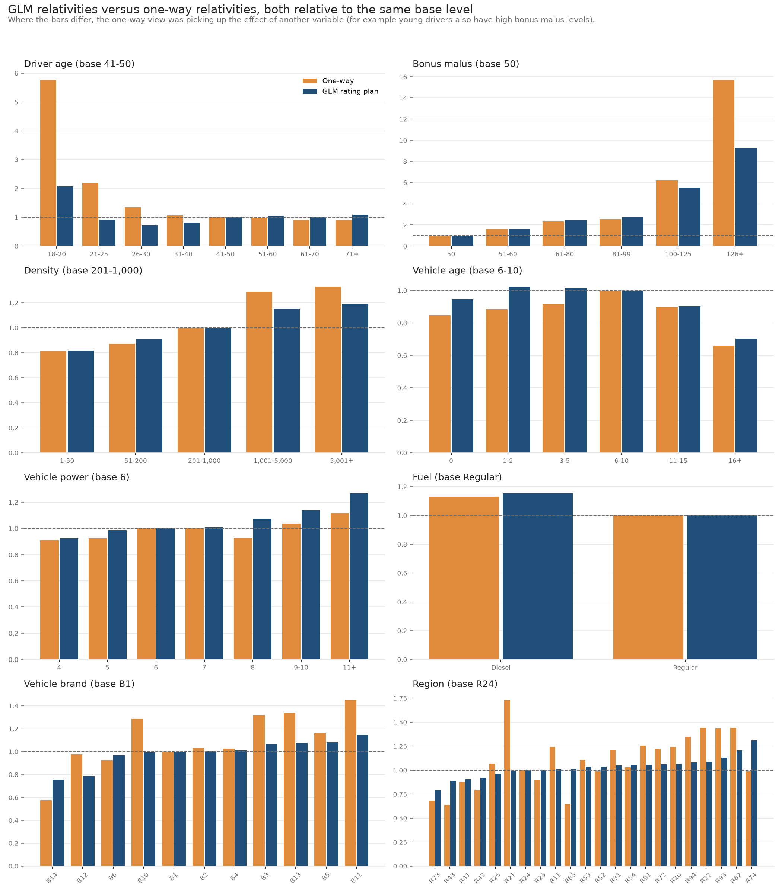
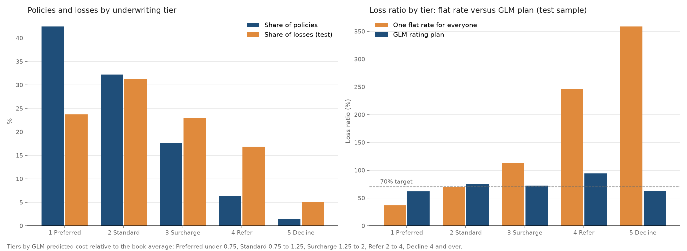
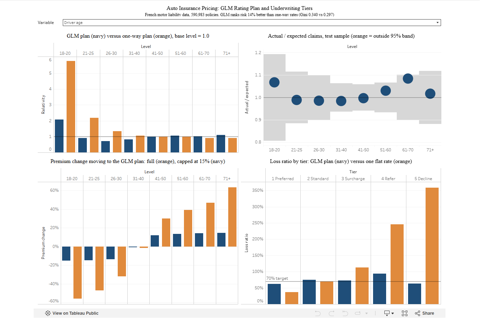

# Auto Insurance Pricing and Underwriting Tiers

**[Read the one page summary](summary.md)** | **[Interactive Tableau dashboard](https://public.tableau.com/app/profile/luosen.wei/viz/AutoPricingGLMandUnderwritingTiers/Pricingdashboard)** | **[Underwriting guidelines memo](notes/underwriting_guidelines.md)**

A full pricing exercise on 590,983 French motor third party liability policies: clean the data, build frequency and severity GLMs, turn them into a rating plan (a base rate and a table of rating factors), test it on policies the models never saw, measure what switching to it would do to customers' premiums, and use it to sort policies into underwriting tiers.

**Tools:** Python (pandas, statsmodels, scikit-learn, matplotlib), Tableau, Git



## Key findings

All results are on the test sample (118,358 policies held out from model building) unless noted.

- **The GLM rating plan ranks risk about 14% better than a one-way plan** (Gini 0.340 versus 0.297). A Tweedie GLM (0.348) and gradient boosted trees (0.335) did no better, so the simpler, explainable GLM plan was kept.
- **One-way rates double count overlapping factors.** On their own, drivers aged 18 to 20 look 5.8 times as costly as drivers aged 41 to 50; in the GLM the factor is 2.1, because new French drivers start at a bonus malus of 100 and that surcharge already carries most of the young driver effect. Where the two plans disagree, actual losses run 0.49 to 2.28 times the one-way premium but 0.88 to 1.20 times the GLM premium (double lift).
- **Bonus malus drives claim frequency; almost nothing drives claim size.** Policies at bonus malus 100 to 125 have 5.5 times the claim frequency of the best level (50). In the severity model only driver age was significant (p = 0.03), so it is the only severity factor.
- **The plan holds up by segment.** Claim count actual versus expected: 5 of 67 segments fall outside a 95% band, close to the 3 or 4 expected by chance, with no pattern across neighboring levels.
- **Switching from the one-way plan would raise 72% of premiums** (median +22%) at the same total premium: drivers 18 to 20 fall 56% on average, drivers 71 and over rise 63%. Capping changes at plus or minus 15% puts 77% of policies at the cap; the median policy reaches its GLM rate at the second renewal.
- **One flat rate would hide a large cross subsidy.** By underwriting tier, a flat rate gives loss ratios from 37% (Preferred, 42% of policies) to 359% (Decline, 1.4% of policies). The GLM plan brings every tier to between 62% and 94% against a 70% target.



## Dashboard

[Tableau Public dashboard](https://public.tableau.com/app/profile/luosen.wei/viz/AutoPricingGLMandUnderwritingTiers/Pricingdashboard): rating factors, actual versus expected, premium change by segment and loss ratio by tier, with one dropdown to switch rating variables.



## Data

freMTPL2freq and freMTPL2sev (French motor third party liability, one year of policies and claims), loaded from OpenML (data ids 41214 and 41215) with scikit-learn. Amounts are in euros.

| | Raw | Cleaned |
| --- | --- | --- |
| Policies | 678,013 | 590,983 |
| Policy years of exposure | 358,499 | 305,463 |
| Claims with an amount | 26,639 | 21,878 |
| Claim amounts | 60,697,931 | 49,669,589 |

Main cleaning decisions (all logged with numbers in [notes/decisions.md](notes/decisions.md)):
- **Dropped policy IDs up to 1,000,000** (87,030 policies, 15% of exposure). In that block, 68% of policies with a claim had no claim amount and the reported claim frequency was 3.7 times the rest of the book with the same mix of drivers, so the claim counts there are unreliable.
- **Capped each claim at 100,000** for the severity model (34 claims); the excess comes back as a flat large loss loading of 1.2182.
- **Capped exposure at 1 year** (1,224 policies) and dropped 195 claim amounts with no matching policy.
- Raw claim amounts minus kept minus dropped = 0.00.

Data dictionary: [notes/data_dictionary.md](notes/data_dictionary.md).

## Method

| Step | What | Script |
| --- | --- | --- |
| 1 | Download, clean, 80/20 train and test split by policy | 01_get_data.py, 02_clean.py |
| 2 | One-way frequency, severity and pure premium by rating variable | 03_one_way.py |
| 3 | Frequency GLM (Poisson, log link, log exposure offset) and severity GLM (Gamma, log link, weighted by claim count); variable tests | 04_glm.py |
| 4 | Rating plan: base rate and rating factors, rebalanced to actual losses | 05_rating_plan.py |
| 5 | Validation: Gini, lift, double lift, actual versus expected, Tweedie and boosted tree benchmarks | 06_validate.py |
| 6 | Impact analysis with plus or minus 15% capping | 07_impact.py |
| 7 | Underwriting tiers and guidelines | 08_tiers.py |
| 8 | Data export for Tableau | 09_export_tableau.py |

**Rating plan.** Pure premium per policy year = base rate x driver age factor x bonus malus factor x vehicle age factor x vehicle power factor x density factor x fuel factor x brand factor x region factor. Each factor = frequency relativity x severity relativity from the GLMs. Base rate: 107.23 per policy year (model 104.64 x off-balance factor 1.0248). Full factor tables: [output/tables/rating_plan.csv](output/tables/rating_plan.csv).

| Measure | Formula |
| --- | --- |
| Claim frequency | claims / exposure |
| Claim severity | capped claim amounts / claims |
| Pure premium | capped claim amounts x large loss loading / exposure |
| Loss ratio | losses / premium, with premium = pure premium / 0.70 |
| Gini | 1 minus 2 x area under the Lorenz curve of losses, policies sorted by predicted cost |

## Model checks

| Check | Result |
| --- | --- |
| Predicted / actual claims, training sample | 1.000 |
| Predicted / actual claims, test sample | 0.990 |
| Frequency variables significant (Wald test) | 8 of 8, p below 0.001 |
| Severity variables significant (likelihood ratio test) | driver age only |
| Claim count actual / expected outside 95% band | 5 of 67 segments |

## How to reproduce

Python 3.11 or later. From the project folder:

```
python -m venv .venv
.venv\Scripts\python -m pip install -r requirements.txt
.venv\Scripts\python scripts\01_get_data.py
```

Then run scripts 02 to 09 in order. Each prints its checks and writes its tables to `output/tables/` and charts to `output/charts/`. Raw and cleaned data stay in `data/`, which is not in the repo.

## Repo structure

```
summary.md        one page summary for a non technical reader
scripts/          Python scripts, run 01 to 09; common.py holds shared bands and helpers
output/tables/    results tables
output/charts/    charts
dashboard/        Tableau data files and screenshot
notes/            decisions log, data dictionary, underwriting guidelines
```
